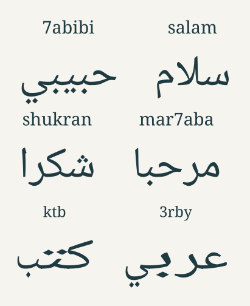

# Arabizi Annotated

A real OpenType font that displays joined Arabic with the **original Arabizi
shorthand above it**. Both rows are drawn by the font. Copying, searching and
accessibility APIs retain the Latin/digit input.

[Download the font](arabizi-font.ttf) · [Interactive playground](playground.html)



## Try it

From the repository root, run:

```sh
python3 -m http.server 8000
```

Open <http://localhost:8000/decoders/arabizi/playground.html>. Try `salam 7abibi`,
`keefak?`, `mar7aba`, or `shukran`. The playground only splits the source into
word runs and assigns the font; it contains no transliterator. Its lines place
word runs right-to-left, with the exact source above each Arabic word reading
left-to-right. Punctuation also separates word runs, so `salam,7abibi` reads
in the same RTL order as `salam, 7abibi`, and trailing punctuation appears
to the left of its Arabic word. Brackets follow RTL mirroring; digit/apostrophe
spellings such as `3'` remain intact. Size, example, source-only and copy
controls are included.

Install `arabizi-font.ttf` to use **Arabizi Annotated** in another application.
Enable required ligatures (`rlig`) and kerning (`kern`). Keep each word in one
LTR shaping run, with consistent formatting. The font reverses the Arabic row
**within** each word. Applications control paragraph direction: an ordinary LTR
document retains LTR word order. An RTL override over Latin source is not
supported. The browser supplies separate LTR word runs in an RTL line for this
reason. Avoid letter spacing, which separates the joining cells.

## Mapping

Arabizi has no single spelling convention. This is a deterministic experimental
mapping, not a language model, translator, or Arabic spelling corrector.

| Input | Arabic | Input | Arabic |
| --- | --- | --- | --- |
| `b` | ب | `t` | ت |
| `th` | ث | `j`, `g` | ج |
| `7`, `H` | ح | `kh`, `5`, `7'`, `x` | خ |
| `d` | د | `dh` | ذ |
| `r` | ر | `z` | ز |
| `s` | س | `sh`, `ch` | ش |
| `9`, `S` | ص | `9'`, `D` | ض |
| `6`, `T` | ط | `6'`, `Z` | ظ |
| `3` | ع | `gh`, `3'` | غ |
| `f` | ف | `8`, `q` | ق |
| `k`, `c` | ك | `l` | ل |
| `m` | م | `n` | ن |
| `h` | ه | `2`, `'` | ء |
| `a`, `aa` | ا | `e`, `i`, `y`, `ee`, `ii` | ي |
| `o`, `u`, `w`, `oo`, `uu` | و | `p`, `v` | پ, ڤ |

Digraphs take precedence over singles, and preserve the exact typed case in the
annotation. Other capitals follow their lowercase mapping, except `S D T Z H`
shown above. `Sh`, `SH` and `sH` all map to ش. Digits 0, 1 and 4 remain literal.
Straight ASCII apostrophes participate in the mappings; curly apostrophes do not.

Twelve explicit, lowercase, **whole-word** shortcuts handle familiar spellings
whose short vowels would otherwise produce extra letters:

| Source | Arabic |
| --- | --- |
| `7abibi`, `habibi` | حبيبي |
| `salam`, `salaam` | سلام |
| `shukran`, `shokran` | شكرا |
| `mar7aba`, `mar7ba` | مرحبا |
| `3arabi` | عربي |
| `keefak`, `kifak` | كيفك |
| `ahlan` | اهلا |

All other words use literal mappings. For instance, `7byby` produces حبيبي and
`ktb` produces كتب; single vowels are not inferred or removed. These shortcuts
do not apply inside a longer word. They use proportional, pre-shaped Arabic;
the general alphabet uses fixed-width joining cells with Arabic outlines
stretched horizontally to meet their neighbors. Lam–alef ligatures are present
in pre-shaped words where applicable; general token output joins individual
letters without a dedicated lam–alef ligature.

## How the font works

1. GSUB recognizes guarded common words, then tokenizes digraphs and singles.
2. Words over **32 tokens** fall back entirely to their original Latin outlines.
   A digraph counts as one token; there is no bound on paragraph word count.
3. Contextual GSUB chooses isolated, initial, medial or final Arabic forms,
   accounting for letters such as ا and ر that cannot join the next letter.
4. Each token expands into an Arabic glyph and a zero-advance source annotation.
5. Two contextual GPOS lookups count the preceding and following token cells.
   Their offsets reflect only the Arabic row within its word. Additional GPOS
   lookups close the spare cell widths between source tokens, so the annotation
   reads as one proportionally spaced word centered above the Arabic. Source
   order and total word advances stay unchanged.

The browser's JavaScript does none of those five operations. Disabling `rlig`
shows the original text; disabling `kern` prevents Arabic row reversal.
Unsupported ASCII punctuation remains visible and breaks token words. Native
Arabic and other non-ASCII input are outside this experimental font's cmap.
Long words, formatting splits, application shaping limits, arbitrary mixed
scripts, and Arabic linguistic correctness are not solved by this prototype.

## Build and test

Requires Python 3.10+, FontTools, and the HarfBuzz `hb-shape` command. The bundled
Noto source and license make builds independent of network access.

```sh
python3 -m pip install fonttools
python3 decoders/arabizi/build.py
python3 decoders/arabizi/build.py --output /tmp/arabizi.ttf
python3 -m unittest discover -s decoders/arabizi -v
```

The builder samples the source font's Arabic forms using HarfBuzz, including
positioned dot components; it instantiates weight 400 with FontTools and
constructs a separate, distinctly named font. It never modifies the source.
`--output` paths resolve from the current directory. Importing the builder
has no side effects. Equivalent shaping needs compatible FontTools/HarfBuzz;
outline serialization is not promised to be identical across tool versions.

Tests shape every token, all shortcuts and embedded-word rejection, Arabic
joins and breaks, independent row positions, proportional source spacing and centering, maximum/overlong words and
recovery, punctuation, disabled substitutions, metadata, source protection,
and agreement between a fresh build and the bundled font.

For browser layout checks, serve the repository and open
[test_playground.html](test_playground.html). It reports pass/fail results for
punctuation order with and without spaces, attached-punctuation wrapping,
Arabizi digraph preservation, brackets, and source-only text preservation.
The punctuation cases run at both 400 px and 1100 px viewport widths.

## License and source

The builder and tests are Apache-2.0. **The generated font is SIL OFL 1.1**, as
it derives from Noto Naskh Arabic (including its Latin outlines). Its embedded
metadata retains upstream copyright and identifies the modifications.
The bundled source, upstream revision, checksums and original license are
in [fonts/](fonts/readme.md). See also the root [third-party notices](../../THIRD_PARTY_NOTICES.md).
